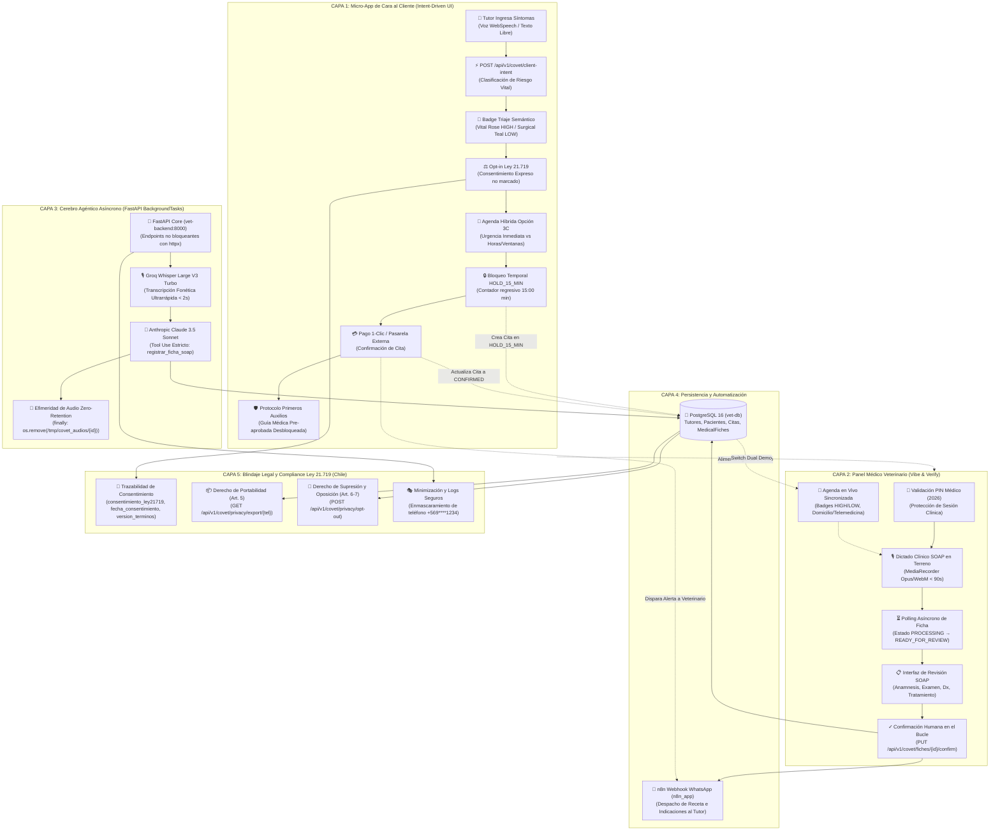

# MAPA MENTAL Y ARQUITECTURA TÉCNICA — COVET SAAS 2026
**Sistema Multi-Agente de Triaje Autónomo, Dictado SOAP con IA & Blindaje Legal Ley 21.719**
*Monorepo Hetzner VPS (Ubuntu 24.04 / Coolify) + Vercel Edge Frontend*

---

## 1. Diagrama de Arquitectura Global (Mermaid)

---

## 2. Desglose Estructurado de las 5 Capas

### Capa 1: Micro-App de Cara al Cliente (Intent-Driven UI)
- **Acceso Directo**: `/?view=client` (o raíz `/`).
- **Lienzo Minimalista Inicial**: Sin menús de navegación complejos que confundan al tutor en una emergencia. Micrófono central con ondas de radar (`#btn-covet-mic`), barra de texto estilizada y chips clickeables de demostración rápida (*"🚨 Mi gato vomitó y está decaído"*, *"💉 Vacuna anual a domicilio"*).
- **Agente de Triaje en Vivo (`POST /api/v1/covet/client-intent`)**:
  - Clasificación de urgencia (`HIGH`, `MEDIUM`, `LOW`) con badge visual semántico (Vital Rose `#E11D48` para riesgo vital, Surgical Teal `#0D9488` para rutina).
  - Inyección reactiva de 3 preguntas dinámicas formuladas por Claude según el síntoma dictado.
  - **Selector Híbrido de Agenda (Opción 3C)**: Telemedicina Inmediata ($15.000 CLP) o Visita de Urgencia Hoy ($35.000 CLP) para casos graves; horas exactas o franjas horarias flexibles Mañana/Tarde ($25.000 CLP) para rutina.
- **Reserva Temporal (`HOLD_15_MIN`)**: Bloquea el cupo en PostgreSQL con contador regresivo de `15:00` minutos.
- **Detección de Paciente Recurrente**: Cruce automático por WhatsApp que rescata el historial previo y lo adjunta a la ficha del veterinario.
- **Protocolo de Primeros Auxilios Pre-Aprobado**: Se desbloquea tras confirmar la cita con indicaciones inmediatas, prohibiciones de automedicación (toxicidad de paracetamol/ibuprofeno) y aviso legal preventivo.

---

### Capa 2: Panel Médico Veterinario (Vibe & Verify)
- **Acceso Directo**: `/?view=vet` (o desde el Switch Superior `[🩺 Modo Veterinario]`).
- **Seguridad de Acceso por PIN**: Modal de protección clínica que requiere el PIN `2026` para acceder a fichas médicas, con botón de auto-desbloqueo en 1 clic para demos de venta.
- **Flujo Vibe & Verify en Terreno**:
  - Dictado clínico libre de menos de 90 segundos mediante `MediaRecorder` nativo en formato Opus/WebM.
  - El veterinario habla en lenguaje natural (*"Paciente canino Golden Retriever, 3 años, presenta diarrea acuosa de 24 hrs..."*).
  - Polling reactivo cada 2 segundos sin congelar la interfaz.
  - Formulario de revisión editable estructurado bajo estándar **SOAP**:
    - **S**ubjetivo: Anamnesis y motivo de consulta.
    - **O**bjetivo: Constantes vitales y examen físico.
    - **A**preciación: Diagnóstico presuntivo o diferencial.
    - **P**lan: Tratamiento farmacológico, dosis y próximos pasos.
- **Agenda Sincronizada en Tiempo Real**: Refresco automático que refleja de inmediato las citas triadas por clientes con badges de urgencia (`HIGH`, `MEDIUM`, `LOW`) y modalidad (`TELEMEDICINA`, `DOMICILIO`).
- **Confirmación Humana**: Al pulsar `[✓] Confirmar Ficha y Enviar por WhatsApp`, se guardan los cambios validados por el médico en PostgreSQL y se notifica al tutor.

---

### Capa 3: Cerebro Agéntico Asíncrono (FastAPI BackgroundTasks)
- **FastAPI Core (`backend/main.py`)**: Arquitectura asíncrona de consumo ultra-bajo en RAM sin dependencias pesadas de Celery ni Redis en producción.
- **Groq Whisper Large V3 Turbo**: Transcripción fonética adaptada al español clínico y jerga veterinaria chilena en menos de 2 segundos.
- **Anthropic Claude 3.5 Sonnet con Tool Use Estricto**:
  - Utiliza `tools` con esquema JSON schema rígido (`registrar_ficha_soap` y `evaluar_intencion_triaje`).
  - Cero alucinaciones: si una constante vital o dosis no fue dictada expresamente, se consigna como `"No especificado en dictado"`.
- **Higiene de Archivos (Zero Audio Retention)**: Guardado en `/tmp/covet_audios/{task_id}.{ext}` con borrado garantizado dentro de un bloque `finally:` inmediatamente concluida la transcripción.

---

### Capa 4: Persistencia y Automatización
- **PostgreSQL 16 (`vet-db` en red Coolify)**:
  - Tablas: `tutores`, `pacientes`, `citas`, `medical_fiches`.
  - Migraciones seguras e idempotentes en caliente (`run_safe_migrations`) con `ALTER TABLE ... ADD COLUMN IF NOT EXISTS`.
  - Soporte de campos JSONB para respuestas dinámicas de triaje y esquemas SOAP complejos.
- **Webhook n8n WhatsApp (`n8n_app`)**:
  - Disparado exclusivamente tras la validación humana del veterinario.
  - Notifica al tutor por WhatsApp con resumen de la atención, receta en PDF y recomendaciones de cuidado.

---

### Capa 5: Blindaje Legal y Compliance Ley 21.719 (Chile)
- **Trazabilidad de Consentimiento**:
  - Columnas en base de datos: `consentimiento_ley21719` (Boolean), `fecha_consentimiento` (Timestamp), `version_terminos` (`v1.0-2026`), `activo_whatsapp` (Boolean).
  - Checkbox de Opt-in obligatorio no premarcado en la Micro-App del cliente.
  - Modal accesible con las 4 dimensiones éticas: Finalidad médica, Efimeridad de voz, Procesamiento cifrado y Derechos ARSOP+.
- **Endpoints de Derechos ARSOP+**:
  - **Portabilidad (Art. 5)**: `GET /api/v1/covet/privacy/export/{telefono}` exporta en JSON estructurado todos los datos personales, mascotas, citas y fichas clínicas del titular.
  - **Supresión y Oposición (Art. 6 y 7)**: `POST /api/v1/covet/privacy/opt-out` permite revocar alertas de WhatsApp (`activo_whatsapp = False`) o anonimizar por completo los datos de contacto personales preservando la trazabilidad epidemiológica disociada.
- **Minimización de Datos en Logs**: Función `mask_phone()` que enmascara números telefónicos en consola (`+569****1234`).

---

## 3. Matriz de Accesos por Rol

| Rol / Perfil | URL de Acceso | Método de Autenticación | Funcionalidad Principal |
| :--- | :--- | :--- | :--- |
| **🐾 Cliente / Tutor** | `/?view=client` o `/` | Libre (Acceso por Link/QR del veterinario) | Triaje de síntomas por voz/texto, consentimiento Ley 21.719, reserva en 15 min, pago y guía de primeros auxilios. |
| **🩺 Médico Veterinario** | `/?view=vet` o Switch Demo | PIN Rápido (`2026`) con auto-desbloqueo | Dictado SOAP &lt; 90s, verificación humana Vibe & Verify, agenda híbrida en vivo e historial clínico. |
| **⚡ SuperAdmin (Sasha)** | `/?view=admin` o Switch Sasha | Directo / Consola Ejecutiva | Métricas del SaaS, tasa de consentimiento Ley 21.719, estado de salud Hetzner/APIs y pruebas de pipeline. |

---

## 4. Comandos Operativos de Referencia
- **Compilación de Frontend**: `cd /home/ashasasha/vet/frontend && npm run build`
- **Reinicio de Backend**: `docker restart vet-backend`
- **Verificación de Salud**: `curl -s http://127.0.0.1:8090/health | jq .`
- **Métricas SuperAdmin**: `curl -s http://127.0.0.1:8090/api/v1/covet/admin/metrics | jq .`
- **Exportación ARSOP+**: `curl -s http://127.0.0.1:8090/api/v1/covet/privacy/export/+56912345678 | jq .`
